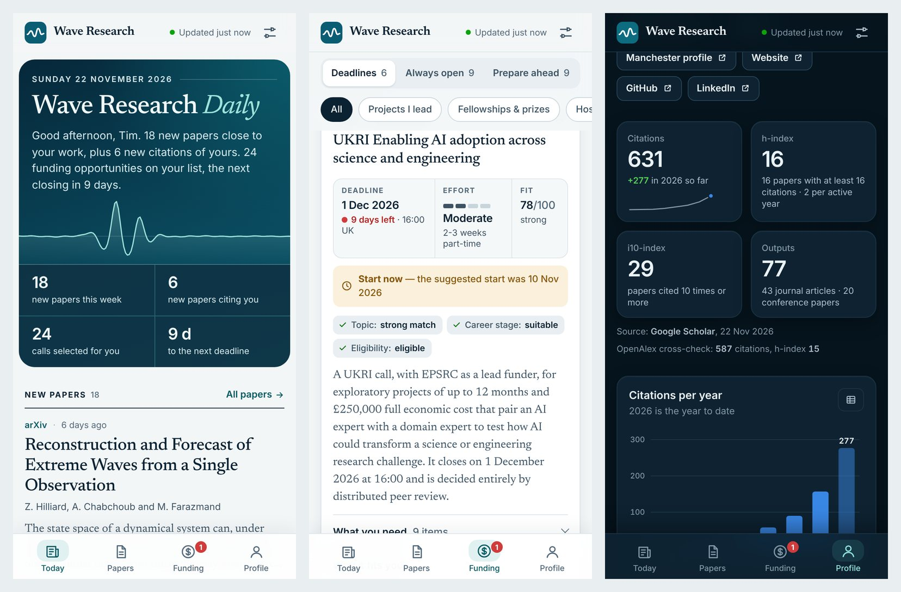

# Wave Research

A personal research briefing that lives on GitHub Pages and is built for a phone.



| Screen | What it shows |
| --- | --- |
| **Today** | The front page: new papers close to your work, new papers citing you, funding calls and the next deadlines. |
| **Papers** | A daily feed of *new* work (not a literature review), ranked against your own publications, plus a live search of all journals scored the same way. |
| **Funding** | A short list of opportunities that pass **both** tests — your research topic *and* your career stage — each with its deadline, a checklist of what to submit, an effort estimate and a "start by" date. Recurring calls that are not open yet appear under *Prepare ahead*. |
| **Profile** | Your publication record and metrics: citations, h-index, trends, themes, journals, collaborators and the full list. |

Live site: **https://nbjdttn.github.io/wave-research-dashboard/** (after step 1 below).

## Set-up — two steps, both doable from a phone

**1. Turn on GitHub Pages**

Repository → **Settings → Pages → Build and deployment**: Source **Deploy from a branch**, pick the
branch that holds this code and the folder **/ (root)**, then **Save**. The site is live about a minute later.

**2. Add your Claude API key** (this is what keeps the funding list reviewed every day)

Repository → **Settings → Secrets and variables → Actions → New repository secret**

- Name: `ANTHROPIC_API_KEY`
- Value: a key from the [Claude Console](https://platform.claude.com/)

The key stays inside GitHub's secret store. It is used only by the scheduled job and is never part of
the web page. Then open **Actions → Update data → Run workflow** once, or simply wait for the next morning.

That is all. To install it like an app, open the site on your phone and choose *Add to Home Screen*.

### Optional settings

| Where | Name | Purpose |
| --- | --- | --- |
| Actions **variable** | `CLAUDE_MODEL` | Model used for the reviews. Default `claude-opus-5-5`. Set `claude-sonnet-5-5` or `claude-haiku-5-5` to spend less. |
| Actions **secret** | `S2_API_KEY` | A free [Semantic Scholar](https://www.semanticscholar.org/product/api) key makes the recommendations and "citing you" steps dependable (without one they share a public rate limit and are sometimes skipped). |
| Actions **secret** | `OPENALEX_API_KEY` | A free [OpenAlex](https://openalex.org/) key adds a fourth source to the papers feed. |

## How the daily update works

`.github/workflows/update.yml` runs every day at 05:17 UTC (and on demand). It runs
`python scripts/update.py`, commits the refreshed files in `data/`, and Pages republishes the site.

```
profile   Google Scholar profile page ─┐
          ORCID · Crossref · OpenAlex ─┴─► data/profile.json   (metrics, publications, history)

papers    Semantic Scholar recommendations (seeded with your papers)
          arXiv · Crossref · papers citing you ─► scored against your own work ─► data/papers.json

grants    UKRI Funding Finder (live calls + two years of past calls, to spot repeats)
          EU Funding & Tenders portal · watch-list of funder schemes (config/schemes.json)
             │  1. screen   out-of-field councils and invite-only calls dropped; Claude triages the rest
             │  2. read     full text of each shortlisted call
             │  3. assess   Claude: topic fit · career-stage fit · eligibility · deadline ·
             │              what to submit · effort · does it repeat, and when
             ▼  4. select   only calls passing both the topic and the career-stage test
          data/grants.json
```

Every source is optional: if one is down, the previous data for it is kept and the run still succeeds.
Results are cached by content, so Claude is only asked about calls that are **new or have changed**.

### What Claude costs

The reviews use the Messages API with structured outputs. A full read of one call is roughly
$0.05–0.10 with the default model. The site ships with the current list already reviewed, so a
typical day needs only a handful of calls — expect a few dollars a month. Two guards keep it bounded:
`max_calls_per_run` in `config/researcher.toml` (default 40), and the cache described above. The run
summary on the Actions page shows the number of calls and the estimated cost each day.

Without a key the site still works: the publication record and papers feed update as normal, the
existing funding reviews are kept, and new calls are listed under *Awaiting review*.

## Make it yours

Everything the pipeline knows about you is in **`config/researcher.toml`**:

- **`[career]`** — the career stage Claude reasons about. Please set `phd_award_year`; several
  fellowships hinge on years since the PhD, and until it is set those are flagged *needs checking*.
  `priorities` and `not_wanted` are passed to Claude word for word.
- **`[interests]`** — weighted phrases that rank papers (`core`, `methods`) and look-alike topics to push down (`avoid`).
- **`[papers]`** / **`[grants]`** — time windows, search phrases, thresholds.
- **`[claude]`** — model, effort, spending guard, how often scheme pages are re-read.

`config/schemes.json` is the watch-list of recurring schemes that have no machine-readable feed
(Royal Society, Leverhulme, Royal Academy of Engineering, ERC, …). Add or remove entries freely.

Edits take effect on the next run.

## Good to know

- **It is public.** A public repository means the site and the files in `data/` are public, including
  the fit notes written about each funding call. The page asks search engines not to index it, but
  anyone with the link can read it. Reading list, shortlist and ticked checklist items are stored
  only in the browser of the device you use.
- **Dates marked `~` are estimates** inferred from earlier rounds. Always confirm on the funder's page —
  each card links to it.
- **Google Scholar** has no API. The job reads your public profile page once a day (which Scholar's
  robots.txt permits). If Scholar blocks a run, the previous numbers are kept and the Settings sheet says so.
- **Some funder sites block scripts** (Leverhulme, ICE). With a Claude key those pages are looked up
  with Claude's web search tool about once a fortnight instead.
- GitHub pauses scheduled workflows in repositories with no activity for 60 days; the daily data
  commit counts as activity, so this one keeps itself awake.

## Run it locally

```bash
pip install -r requirements.txt
python scripts/update.py            # or: profile | papers | grants
python -m http.server 8000          # then open http://localhost:8000
```

Set `ANTHROPIC_API_KEY` in your shell to include the Claude reviews. `scripts/seed_tools.py` can
export the same briefs for review by hand and import the answers.

## Layout

```
index.html, sw.js, manifest.webmanifest   the app shell (no build step, no dependencies)
assets/css, assets/js                     interface: views, charts, similarity scoring
assets/fonts                              Inter and Newsreader (SIL Open Font License)
config/                                   researcher.toml, schemes.json
data/                                     generated JSON (+ data/cache, the pipeline's memory)
scripts/update.py, scripts/wave/          the data pipeline (Python)
.github/workflows/update.yml              the daily job
```
